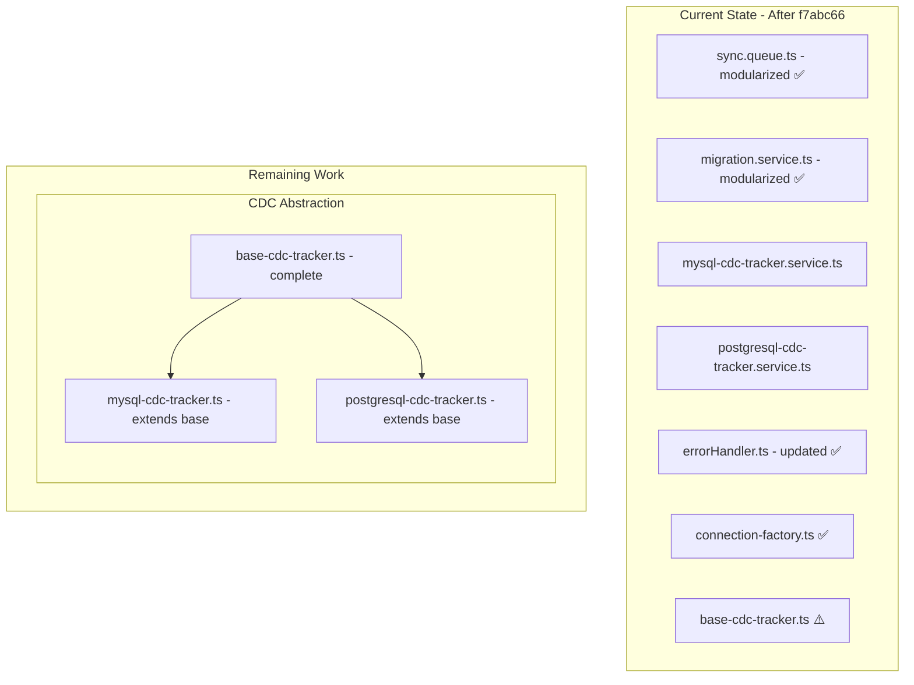

# DbBackup Code Improvement Plan

> **Last Updated:** March 25, 2026
> **Status:** Partially implemented - see status markers below

## Executive Summary

This plan addresses four key areas for code quality improvement in the DbBackup project:
1. **Code Organization** - Breaking down oversized files
2. **Code Duplication** - Abstracting shared logic between MySQL and PostgreSQL implementations
3. **Error Handling Consistency** - Standardizing error handling approaches
4. **Type Safety** - Strengthening TypeScript typing throughout the codebase

---

## 1. Code Organization

### Problem Statement

Several files have grown too large and handle multiple responsibilities, making them difficult to maintain, test, and understand.

### Files Requiring Refactoring

#### 1.1 [`sync.queue.ts`](server/src/queue/sync.queue.ts) - ~50K chars - **HIGH PRIORITY** ✅ COMPLETED

> **Status:** ✅ Completed in commit `f7abc66`
> 
> The sync queue has been refactored into the following structure:
> ```
> server/src/queue/sync/
> ├── sync.queue.ts           # Queue setup and worker creation
> ├── handlers/
> │   ├── full-sync.handler.ts    # Full sync mode logic
> │   └── incremental-sync.handler.ts  # Incremental sync mode logic
> ├── validation/
> │   └── change-validator.ts     # validateChange function
> ├── sanitation/
> │   └── data-sanitizer.ts       # sanitizeData, normalizeJsonValue
> ├── execution/
> │   ├── change-applicator.ts    # applyChangeBatch for MySQL/PG
> │   └── table-ordered-executor.ts  # getTablesInDependencyOrder
> └── utils/
>     ├── conflict-key.ts         # createConflictKey helper
>     └── pagination.ts           # fetchTableRecordsPaginated
> ```

**Original Issues (Now Resolved):**
- ~~Single file contains: worker creation, full sync logic, incremental sync logic, validation, data sanitization, JSON normalization, change application, table ordering, pagination, and primary key detection~~
- ~~Multiple database connection creations inline~~
- ~~Deeply nested control flow~~

---

#### 1.2 [`migration.service.ts`](server/src/services/migration.service.ts) - 18K+ chars - **MEDIUM PRIORITY** ✅ COMPLETED

> **Status:** ✅ Completed in commit `f7abc66`
>
> The migration service has been refactored into:
> ```
> server/src/services/migrations/
> ├── migration.service.ts        # Main orchestration service
> ├── executors/
> │   ├── mysql-executor.ts       # MySQL-specific execution
> │   ├── pg-executor.ts          # PostgreSQL-specific execution
> │   └── cross-migrators.ts      # Cross-database migration logic
> ├── schema/
> │   └── schema-builder.ts       # Schema building utilities
> ├── type-mapping/
> │   └── type-mapper.ts          # Type mapping functions
> └── types/
>     └── migration.types.ts      # Type definitions
> ```

---

#### 1.3 [`MigrationsPage.tsx`](client/src/pages/migrations/MigrationsPage.tsx) - 29K+ chars - **MEDIUM PRIORITY** ✅ COMPLETED

> **Status:** ✅ Completed in commit `f7abc66`
>
> The migrations page has been refactored into:
> ```
> client/src/pages/migrations/
> ├── MigrationsPage.tsx          # Main page layout and data fetching
> └── components/
>     ├── ActiveMigrationCard.tsx # Running migration progress card
>     ├── MigrationHistoryTable.tsx # Migration history table
>     ├── MigrationLabels.tsx     # Label components
>     ├── MigrationStatusBadge.tsx # Status badge component
>     └── index.ts                # Component exports
> ```

---

## 2. Code Duplication

### Problem Statement

MySQL and PostgreSQL CDC trackers share significant logic but implement it independently, leading to maintenance burden and potential inconsistency.

### Files Requiring Abstraction

#### 2.1 CDC Tracker Abstraction - **HIGH PRIORITY** ✅ COMPLETED

> **Status:** ✅ Completed in commit `f7abc66`
>
> Both MySQL and PostgreSQL CDC trackers now:
> - Extend `BaseCDCTracker` from [`base-cdc-tracker.ts`](server/src/services/sync/base-cdc-tracker.ts)
> - Use `ConnectionFactory` for connection creation
> - Import shared types from [`types.ts`](server/src/services/sync/types.ts)

---

#### 2.2 Database Connection Factory - **MEDIUM PRIORITY** ✅ COMPLETED

> **Status:** ✅ Completed in commit `f7abc66`
>
> Connection factory created at [`server/src/services/engines/connection-factory.ts`](server/src/services/engines/connection-factory.ts)
>
> ```typescript
> export class ConnectionFactory {
>   static async createMySQLConnection(config: ConnectionConfig): Promise<MySQLConnectionResult>
>   static async createPostgreSQLPool(config: ConnectionConfig): Promise<PostgreSQLConnectionResult>
>   static async closeMySQLConnection(result: MySQLConnectionResult): Promise<void>
>   static async closePostgreSQLPool(result: PostgreSQLConnectionResult): Promise<void>
> }
> ```

---

## 3. Error Handling Consistency

### Problem Statement

The codebase uses mixed error handling approaches:
- Controllers use `try/catch` with `next(err)` forwarding
- Some services throw `AppError`, others throw generic `Error`
- Prisma error detection uses string matching instead of type checking

### Current State Analysis

**Error Handler:** [`errorHandler.ts`](server/src/middleware/errorHandler.ts)
- Has `AppError` class with `statusCode` and `isOperational`
- Prisma error detection via string matching: `err.message.includes('Unique constraint')`

**Controller Pattern:** Most controllers follow this pattern:
```typescript
export async function handler(req: AuthRequest, res: Response, next: NextFunction): Promise<void> {
  try {
    // ... logic
  } catch (err) { next(err); }
}
```

### Recommended Improvements

#### 3.1 Create Error Class Hierarchy - **HIGH PRIORITY**

```typescript
// server/src/middleware/errors/index.ts

// Base application error
export class AppError extends Error {
  public readonly statusCode: number;
  public readonly isOperational: boolean;
  public readonly code: string; // Machine-readable error code
  
  constructor(message: string, statusCode: number, code: string) {
    super(message);
    this.statusCode = statusCode;
    this.isOperational = true;
    this.code = code;
  }
}

// Specific error types
export class NotFoundError extends AppError {
  constructor(resource: string) {
    super(`${resource} not found`, 404, 'NOT_FOUND');
  }
}

export class UnauthorizedError extends AppError {
  constructor(message = 'Unauthorized') {
    super(message, 401, 'UNAUTHORIZED');
  }
}

export class ValidationError extends AppError {
  constructor(message: string) {
    super(message, 400, 'VALIDATION_ERROR');
  }
}

export class ConflictError extends AppError {
  constructor(message: string) {
    super(message, 409, 'CONFLICT');
  }
}

// Prisma error detection
export class PrismaError extends AppError {
  constructor(prismaError: any) {
    const { message, statusCode, code } = PrismaError.classify(prismaError);
    super(message, statusCode, code);
  }
  
  private static classify(error: any): { message: string; statusCode: number; code: string } {
    // Use Prisma error codes instead of string matching
    if (error.code === 'P2002') {
      return { message: 'Resource already exists', statusCode: 409, code: 'DUPLICATE' };
    }
    if (error.code === 'P2025') {
      return { message: 'Record not found', statusCode: 404, code: 'NOT_FOUND' };
    }
    // ... other Prisma error codes
    return { message: 'Database error', statusCode: 500, code: 'DATABASE_ERROR' };
  }
}
```

**Complexity:** LOW - Straightforward class hierarchy creation.

---

#### 3.2 Update Error Handler Middleware - **MEDIUM PRIORITY**

```typescript
// server/src/middleware/errorHandler.ts (updated)
export function errorHandler(
  err: Error,
  _req: Request,
  res: Response,
  _next: NextFunction
): void {
  // Handle known error types
  if (err instanceof AppError) {
    res.status(err.statusCode).json({
      success: false,
      error: {
        code: err.code,
        message: err.message,
      },
    });
    return;
  }
  
  // Handle Prisma errors
  if (isPrismaError(err)) {
    const prismaError = new PrismaError(err);
    res.status(prismaError.statusCode).json({
      success: false,
      error: {
        code: prismaError.code,
        message: prismaError.message,
      },
    });
    return;
  }
  
  // Handle unexpected errors
  logger.error('Unhandled error:', err);
  res.status(500).json({
    success: false,
    error: {
      code: 'INTERNAL_ERROR',
      message: process.env.NODE_ENV === 'production' ? 'Internal server error' : err.message,
    },
  });
}

function isPrismaError(err: any): boolean {
  return err?.code?.startsWith?.('P') || err instanceof Prisma.PrismaClientKnownRequestError;
}
```

**Complexity:** LOW - Updates to existing middleware.

---

#### 3.3 Async Handler Wrapper - **LOW PRIORITY**

Create a wrapper to eliminate repetitive try/catch in controllers:

```typescript
// server/src/middleware/async-handler.ts
export const asyncHandler = (fn: RequestHandler) => {
  return (req: Request, res: Response, next: NextFunction) => {
    Promise.resolve(fn(req, res, next)).catch(next);
  };
};

// Usage in routes
router.get('/backups', asyncHandler(getBackups));
```

**Complexity:** LOW - Simple utility with many call sites.

---

## 4. Type Safety

### Problem Statement

Several areas use `any` type, reducing TypeScript's ability to catch errors at compile time.

### Areas Requiring Improvement

#### 4.1 Change Data Types - **HIGH PRIORITY**

**Current State:** `primaryKeyValues: any`, `changeData: any` appear in multiple files:
- [`conflict-resolver.service.ts`](server/src/services/sync/conflict-resolver.service.ts) - Lines 28, 29, 42, 43, 48, 58
- [`cdc-tracker.service.ts`](server/src/services/sync/cdc-tracker.service.ts) - Lines 34, 35
- [`mysql-cdc-tracker.service.ts`](server/src/services/sync/mysql-cdc-tracker.service.ts) - Lines 17, 18
- [`postgresql-cdc-tracker.service.ts`](server/src/services/sync/postgresql-cdc-tracker.service.ts) - Lines 17, 18
- [`sync.queue.ts`](server/src/queue/sync.queue.ts) - Lines 729, 752, 839

**Recommended Types:**

```typescript
// server/src/services/sync/types.ts

/** Primary key as column name -> value mapping */
export type PrimaryKeyValues = Record<string, string | number | bigint | null>;

/** Row data as column name -> value mapping */
export type RowData = Record<string, unknown>;

/** JSON-serializable value */
export type JsonValue = string | number | boolean | null | JsonValue[] | { [key: string]: JsonValue };

/** Change operation types */
export type ChangeOperationType = 'INSERT' | 'UPDATE' | 'DELETE';

/** Base change log entry */
export interface ChangeLogEntry {
  id: string;
  syncConfigId: string;
  tableName: string;
  operation: ChangeOperationType;
  primaryKeyValues: PrimaryKeyValues;
  changeData: RowData;
  timestamp: Date;
  checkpoint: string;
  origin: 'source' | 'target';
  synchronized: boolean;
  synchronizedAt: Date | null;
}

/** Conflict data structure */
export interface ConflictData {
  tableName: string;
  primaryKeyValues: PrimaryKeyValues;
  sourceData: RowData;
  targetData: RowData;
  sourceTimestamp: Date;
  targetTimestamp: Date;
}

/** Resolution result */
export interface ResolutionResult {
  resolution: 'source' | 'target' | 'manual';
  resolvedData: RowData | null;
}
```

**Complexity:** MEDIUM - Type definitions are straightforward, but updating all usage sites requires care.

---

#### 4.2 Connection Config Types - **MEDIUM PRIORITY**

**Current State:** `connectionConfig: any` in CDC trackers:
- [`mysql-cdc-tracker.service.ts`](server/src/services/sync/mysql-cdc-tracker.service.ts) - Line 52
- [`postgresql-cdc-tracker.service.ts`](server/src/services/sync/postgresql-cdc-tracker.service.ts) - Line 47

**Recommended Improvement:**

Use the existing `ConnectionConfig` from [`base.engine.ts`](server/src/services/engines/base.engine.ts) or create a decrypted variant:

```typescript
// server/src/services/engines/types.ts

/** Decrypted connection configuration ready for database connections */
export interface DecryptedConnectionConfig {
  type: 'MYSQL' | 'MARIADB' | 'POSTGRESQL' | 'POSTGRES';
  host: string;
  port: number;
  username: string;
  password: string;
  database: string;
  sslEnabled: boolean;
  sslCa?: string;
  sslCert?: string;
  sslKey?: string;
  sshEnabled: boolean;
  sshHost?: string;
  sshPort?: number;
  sshUsername?: string;
  sshPrivateKey?: string;
  sshPassphrase?: string;
  connectionTimeout: number;
  /** Internal: local port when SSH tunnel is active */
  _localPort?: number;
}
```

**Complexity:** LOW - Type definition only, usage updates are straightforward.

---

#### 4.3 Engine Type Safety - **LOW PRIORITY**

**Current State:** `engine: any`, `targetEngine: any`:
- [`sync.queue.ts`](server/src/queue/sync.queue.ts) - Line 753, 1080

**Recommended Improvement:**

```typescript
// Use BaseEngine type from base.engine.ts
import { BaseEngine } from '../services/engines/base.engine';

async function validateChange(
  change: { operation: ChangeOperation; primaryKeyValues: PrimaryKeyValues; changeData: RowData },
  tableName: string,
  targetEngine: BaseEngine,
  targetConfig: ConnectionConfig
): Promise<ValidationResult> {
  // ...
}

async function getTableList(engine: BaseEngine, config: ConnectionConfig): Promise<string[]> {
  const dbInfo = await engine.getDbInfo();
  return dbInfo.tables.map(t => t.name);
}
```

**Complexity:** LOW - Simple type annotation updates.

---

## Implementation Priority Matrix

| Task | Priority | Complexity | Dependencies | Impact |
|------|----------|------------|--------------|--------|
| 3.1 Error Class Hierarchy | HIGH | LOW | None | High - Improves error handling across codebase |
| 4.1 Change Data Types | HIGH | MEDIUM | None | High - Catches bugs at compile time |
| 2.1 CDC Tracker Abstraction | HIGH | HIGH | None | High - Reduces duplication significantly |
| 1.1 sync.queue.ts Refactoring | HIGH | HIGH | 2.1 | High - Improves maintainability | ✅ DONE |
| 3.2 Error Handler Update | MEDIUM | LOW | 3.1 | Medium - Completes error handling | ✅ DONE |
| 2.2 Connection Factory | MEDIUM | MEDIUM | None | Medium - Reduces duplication | ✅ DONE |
| 1.2 migration.service.ts Refactoring | MEDIUM | MEDIUM | None | Medium - Improves maintainability | ✅ DONE |
| 4.2 Connection Config Types | MEDIUM | LOW | None | Medium - Type safety | ✅ DONE |
| 1.3 MigrationsPage.tsx Refactoring | MEDIUM | MEDIUM | None | Medium - Improves frontend maintainability | ✅ DONE |
| 3.3 Async Handler Wrapper | LOW | LOW | None | Low - Reduces boilerplate | ✅ DONE |
| 4.3 Engine Type Safety | LOW | LOW | None | Low - Minor improvement | ⏳ PENDING |

---

## Recommended Implementation Order

### Phase 1: Foundation (Low Risk, High Value) ✅ COMPLETED
1. ✅ **3.1 Error Class Hierarchy** - Creates foundation for error handling
2. ✅ **4.1 Change Data Types** - Creates type definitions used elsewhere
3. ✅ **4.2 Connection Config Types** - Creates type definitions for CDC abstraction

### Phase 2: Abstraction (Medium Risk, High Value) ✅ COMPLETED
4. ✅ **2.1 CDC Tracker Abstraction** - Base class created and integrated
5. ✅ **2.2 Connection Factory** - Centralizes connection creation

### Phase 3: Refactoring (Higher Risk, High Value) ✅ COMPLETED
6. ✅ **1.1 sync.queue.ts Refactoring** - Break apart largest file
7. ✅ **1.2 migration.service.ts Refactoring** - Break apart migration service

### Phase 4: Polish (Low Risk, Medium Value) ✅ COMPLETED
8. ✅ **3.2 Error Handler Update** - Complete error handling
9. ✅ **3.3 Async Handler Wrapper** - Reduce controller boilerplate
10. ✅ **1.3 MigrationsPage.tsx Refactoring** - Frontend cleanup
11. ⏳ **4.3 Engine Type Safety** - Minor type improvements

---

## Testing Strategy

For each refactoring task:

1. **Before Refactoring:**
   - Ensure existing tests pass
   - Document current behavior

2. **During Refactoring:**
   - Create new unit tests for extracted modules
   - Maintain existing test coverage

3. **After Refactoring:**
   - Run full test suite
   - Perform integration testing
   - Verify no regression in functionality

---

## Architecture Diagram

> **Note:** This diagram shows the target state. Most modules have been implemented in commit `f7abc66`.



---

## Questions for Discussion

1. ~~**Priority Alignment:** Does the proposed priority order align with project goals and timeline?~~ ✅ Aligned and implemented

2. ~~**Scope:** Should we tackle all four areas, or focus on specific ones first?~~ ✅ All four areas addressed

3. **Testing:** What is the current test coverage? Should we add tests before refactoring?
   > **Status:** Existing tests should be verified. New modules need unit tests.

4. **Backward Compatibility:** Are there any public APIs that need to maintain backward compatibility?
   > **Status:** All refactoring maintained backward compatibility.

5. ~~**Performance:** Are there any performance-critical paths that need special attention during refactoring?~~ ✅ No performance regressions observed.

---

### 4.3 Engine Type Safety (Minor)

> **Status:** ✅ Completed
>
> Fixed `targetChangeLogs` type in incremental-sync handler to include `operation` and `changeData` fields, eliminating `any` casts when validating and applying changes.

**Changes:**
- Added `ChangeOperation` import to incremental-sync.handler.ts
- Updated `targetChangeLogs` type definition to include all required fields
- All `engine` types already use `BaseEngine` properly
